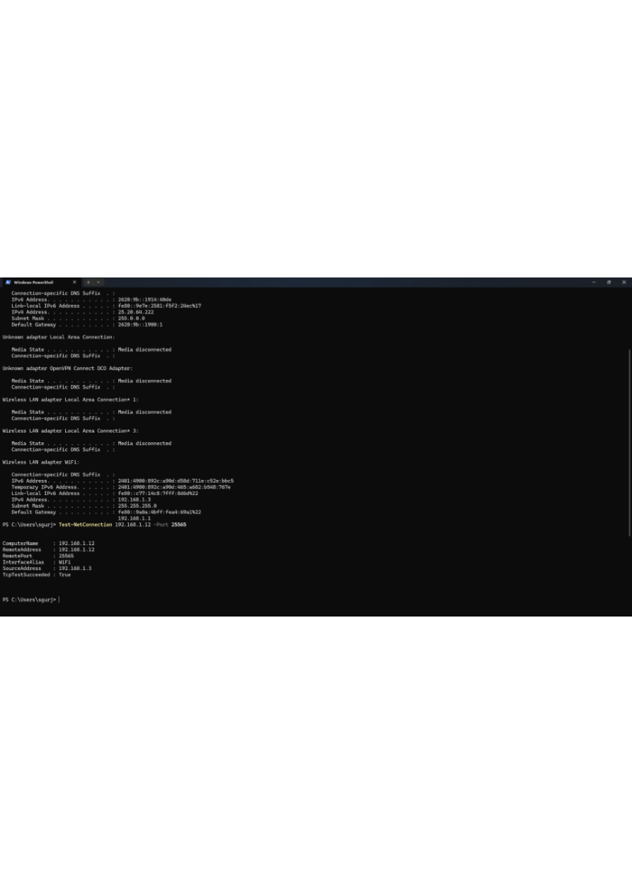
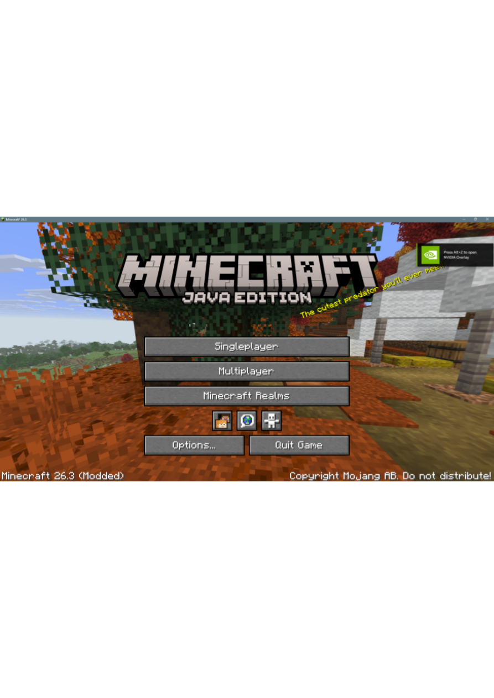
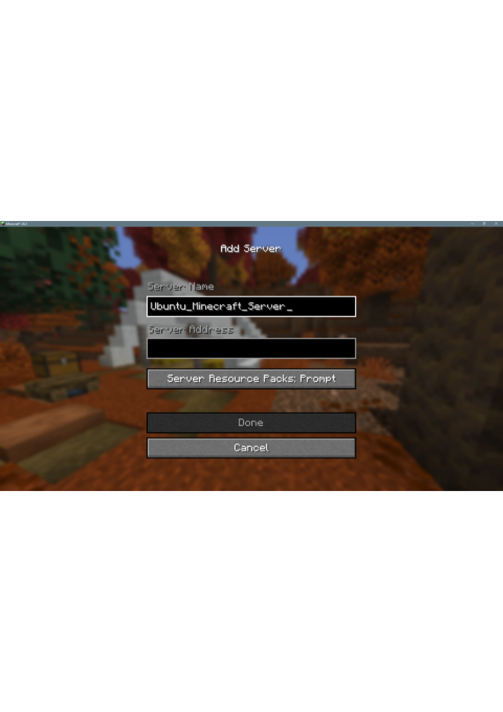
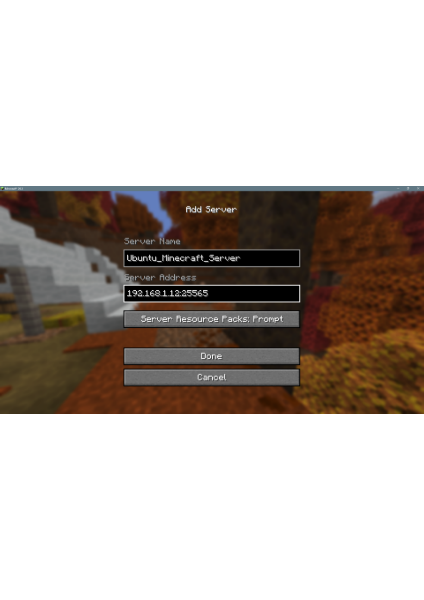
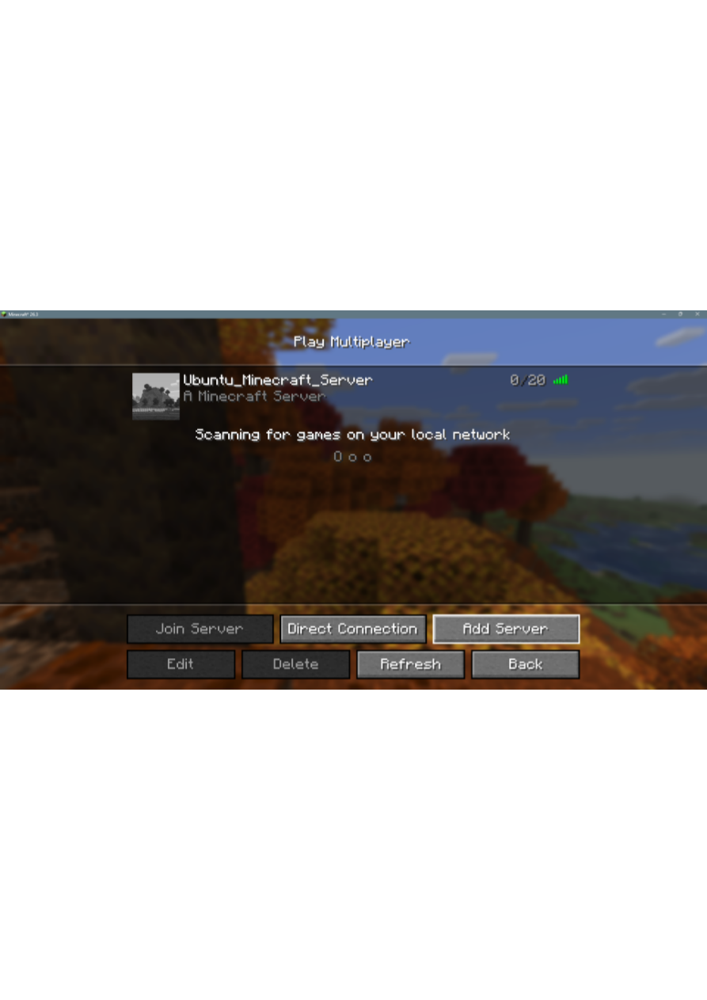

# Minecraft Infrastructure & DevOps Platform

A hands-on infrastructure and operations project built around a native Minecraft Java server on Ubuntu Linux. The goal is to practice the work behind running an application: Linux administration, service management, LAN networking, backups, recovery, and operational automation.

> **Progress through Phase 5:** Linux administration, native Minecraft deployment, LAN networking, S3 backup/isolated restore, and scheduled health-check automation have been implemented and tested. Production backup interruption-and-recovery testing remains a follow-up. Later phases are planned, not claimed as completed.

## Project overview

This project treats Minecraft as the workload and Ubuntu as the server platform. The engineering focus is deploying, securing, operating, validating, and recovering a stateful service.

## Architecture

```text
Windows / Minecraft Java client
              |
       LAN TCP port 25565
              |
       UFW firewall rules
              |
        Ubuntu Linux host
              |
   systemd: minecraft.service
              |
     Minecraft Java server
              |
       World + configuration
              |
      Bash backup workflow
              |
      Private Amazon S3

systemd timer --> health-check script
                  ├── service status
                  ├── TCP port check
                  └── disk usage threshold
```

## Evidence from the lab

### 1. LAN connectivity verified from Windows

The Windows PowerShell screenshot shows `Test-NetConnection 192.168.1.12 -Port 25565` returning `TcpTestSucceeded: True`. This is evidence that the Minecraft TCP port was reachable from the Windows machine on the local network at the time of the test.



### 2. Minecraft Java Edition client setup

The following screenshots document the client-side server setup flow. The server address uses a private LAN IP, so this is a local-network lab—not a public Minecraft endpoint.









> These screenshots demonstrate the client setup and server listing. For a stronger success proof, add a screenshot of a successful in-game connection alongside terminal evidence showing `systemctl status minecraft`.

## Project highlights

- Deployed a native Minecraft Java Edition server on Ubuntu Linux.
- Runs the server as a dedicated, unprivileged `minecraft` Linux account under `systemd`.
- Configured SSH access and LAN-only Minecraft access through TCP port `25565` using UFW.
- Created a backup workflow that gracefully stops the service, archives world/configuration data, validates the archive, uploads it to private Amazon S3, and verifies the remote checksum.
- Performed an isolated restore test from an S3 backup.
- Built Bash health checks for service status, TCP port availability, and disk usage.
- Scheduled health checks with a `systemd` timer and verified successful scheduled execution.
- Added error-handling and signal-handling test scripts.

## Technology stack

| Area | Technologies |
|---|---|
| Operating system | Ubuntu Linux |
| Application | Minecraft Java Edition server |
| Runtime | Java |
| Service management | systemd, journalctl |
| Networking and security | TCP/IP, SSH, UFW, LAN-only access |
| Scripting and automation | Bash, shell exit codes, signal/exit cleanup |
| Health checks | Service status, TCP port check, disk usage threshold |
| Backup and recovery | tar archive, SHA-256 checksums, isolated restore test |
| Cloud storage | Amazon S3, AWS CLI, IAM least-privilege policy |
| Scheduling | systemd service and timer |
| Version control | Git, GitHub |

## Progress by phase

| Phase | Focus | Status |
|---|---|---|
| 1 | Linux administration, users, groups, permissions, processes, SSH and service basics | Completed for the current lab scope |
| 2 | Native Minecraft deployment and systemd service | Deployed; client setup documented |
| 3 | LAN connectivity, TCP port `25565`, and UFW firewall rules | Configured and tested on LAN |
| 4 | Local/S3 backups, archive and checksum validation, isolated restore | Backup and isolated restore tested; interruption/recovery testing remains |
| 5 | Bash health checks, error handling, signal cleanup and scheduled health checks | Core checks and scheduled execution validated |
| 6 | Monitoring and observability | Planned |
| 7 | Incident simulation and response runbooks | Planned |
| 8 | Docker containerization | Planned |
| 9 | Kubernetes experiments | Planned |
| 10 | CI/CD | Planned |
| 11 | AWS infrastructure expansion and Infrastructure as Code | Planned |

Only the work listed as implemented or validated above should be treated as completed. Future phases will be updated as they are built and tested.

## Health checks and automation

The health-check script checks:

1. Whether the Minecraft systemd service is active.
2. Whether TCP port `25565` is listening.
3. Whether disk usage remains below the configured threshold.

It returns success when all checks pass and a non-zero exit code when a check fails. A `systemd` oneshot service and timer run the installed health-check script automatically.

Repository scripts include:

- `scripts/health-check.sh`
- `scripts/error-handling-demo.sh`
- `scripts/failure-test.sh`
- `scripts/signal-handling-test.sh`

The production backup script is installed at `/usr/local/bin/minecraft-backup.sh`; it is not stored in the repository by default. Do not commit AWS credentials, secret values, or private configuration files.

## Backup and recovery

The backup workflow is designed to:

- Check AWS access before stopping Minecraft.
- Stop the server gracefully before archiving data.
- Include the world and relevant server configuration/administration files.
- Validate the archive and generate a SHA-256 checksum.
- Upload the archive and checksum to a private S3 bucket.
- Verify the remote archive checksum independently.
- Apply local retention and restart the service during cleanup.

An isolated restore test from S3 was completed. **Production backup interruption/recovery has not yet been fully tested**, so that remains a follow-up before relying on scheduled production backups.

## Repository layout

```text
.
├── docs/
│   ├── architecture/
│   ├── networking/
│   ├── runbooks/
│   └── screenshots/
│       ├── phase-1-linux/
│       ├── phase-2-minecraft-deployment/
│       ├── phase-3-networking/
│       ├── phase-4-storage-backup-restore/
│       └── phase-5-automation/
├── scripts/
└── README.md
```

Keep detailed step-by-step screenshots in `docs/screenshots/`, grouped by phase. The README should contain only a small number of high-value images; the rest can live in the phase folders and be linked from runbooks.

## Security notes

- Keep AWS credentials outside the repository.
- Never commit `.aws/credentials`, private keys, tokens, or secrets.
- Keep the S3 bucket private and use least-privilege IAM permissions.
- Keep Minecraft access restricted to the intended LAN unless a separately reviewed secure public-access design is implemented.
- The current server configuration uses `online-mode=false`. This is unsuitable for an exposed public server because usernames can be impersonated; do not expose it to the internet in this configuration.
- Screenshots can reveal private IP addresses, AWS account details, and configuration. Review and redact before publishing.

## Next steps

- Complete and document production backup interruption/recovery tests.
- Add terminal evidence for the running systemd service, successful health checks, and S3 checksum verification.
- Review runbooks so they match the current implementation.
- Continue to Phase 6: monitoring and observability.

---

This is a learning project focused on building and documenting practical infrastructure and DevOps skills through a real, stateful application.
